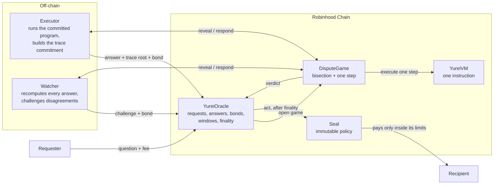

# Architecture

Four contracts on Robinhood Chain, two kinds of off-chain actor.

## Contracts

| Contract | Responsibility | Trusts |
|---|---|---|
| `YureiVM` (library) | Executes exactly one instruction on a 16-register Q16.16 state; hashes states and instructions | Nothing |
| `MerkleLib` (library) | Verifies fixed-depth Merkle proofs | Nothing |
| `DisputeGame` | Runs bisection between an asserter and a challenger over a committed trace, then one step; enforces move deadlines | Its resolver (the oracle) only for who the parties are |
| `YureiOracle` | Registers programs, escrows fees and bonds, verifies trace commitments, opens games, settles bonds, finalizes answers, asks the seal to act | `DisputeGame` for verdicts; the USDG token |
| `Seal` | Holds funds and pays only inside limits fixed at construction; no owner | The oracle address it was built with, and only to *ask* |

## Commitments

- **Program commitment.** A program is a list of instructions. Its root is a Merkle root over
  `keccak256(abi.encode(op, dst, a, b, imm))` for each instruction. A model is identified by
  `keccak256(abi.encode(programRoot, numSteps))`.
- **Trace commitment.** An execution is the list of states S0 (the input) through SN. Its root is
  a Merkle root over `keccak256(abi.encode(int32[16]))` for each state. Missing leaves are zero.
- **Binding the ends.** When answering, the executor proves leaf 0 is the request's input and
  leaf N is the hash of the final state it posts in full. The chain derives the output from that
  final state itself (APPROVE if r13 > r12).

## Actors

- **Requester** asks a question, pays a fee, optionally names a seal and an action.
- **Executor** answers with a bond. Paid fee + bond back at finality; slashed if proven wrong.
- **Watcher / challenger** recomputes answers and challenges with a bond when the final state
  differs. Paid both bonds if right; loses its bond if wrong.

The reference implementations of the executor and watcher are in [`reference/executor.js`](../reference/executor.js).
