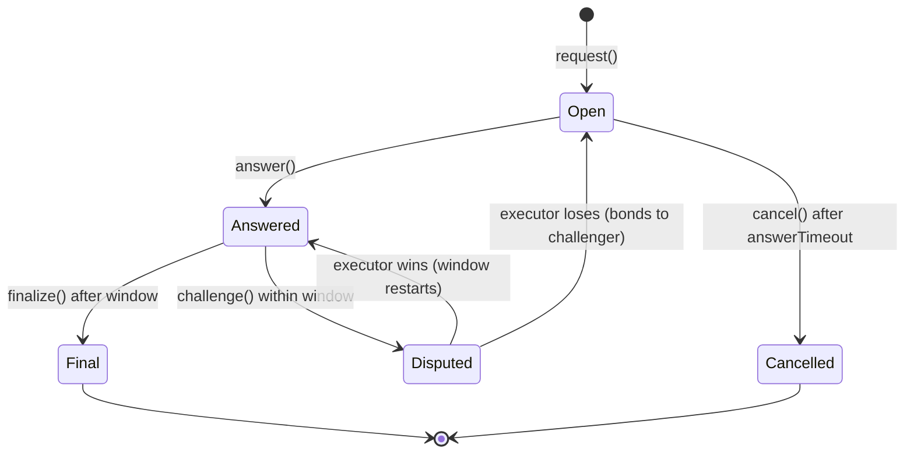

# Request lifecycle

Five stages. Each leaves a record on chain; nothing moves until the record says it may.

## 01 · Request 問

`request(modelId, input, fee, seal, actionTo, actionAmount)`

- The model must be registered and the input must be exactly 16 registers.
- **The seal is consulted first.** If a seal is named and `seal.wouldAllow(actionTo, actionAmount)`
  is false, the request reverts with `SealWouldRefuse` before any fee moves or work is done.
- The fee is escrowed in USDG. The input is emitted in full in `Requested` (for executors) and
  stored only as its hash.

## 02 · Inference 考

`answer(id, traceRoot, finalState, startProof, endProof)`

- The executor runs the committed program off-chain and commits to every state.
- The chain checks that leaf 0 of `traceRoot` is the request's input hash and leaf N is the hash
  of `finalState`, then derives the output from `finalState` (r13 > r12 means APPROVE).
- A bond is escrowed from the executor and the challenge window starts.

## 03 · Challenge 疑

`challenge(id)` within `challengeWindow` of the answer.

- Any address except the executor may challenge, by escrowing an equal bond.
- An honest watcher challenges only when its own recomputed final state differs: the game judges
  the final claim, not intermediate states (see [DISPUTE-GAME](DISPUTE-GAME.md)).
- A `DisputeGame` is opened with the executor as asserter.

## 04 · Proof 証

Played in `DisputeGame`; settled back in the oracle through `onGameResolved`.

- **Executor loses:** both bonds go to the challenger, the answer is erased, the request reopens.
- **Executor wins:** the challenger's bond goes to the executor, and the answer stands with a fresh
  window (so a colluding challenger can only delay a wrong answer, never finalize it).

## 05 · Action 封

`finalize(id)` after the window, with no game open.

- The executor receives the fee and its bond back.
- If a seal was named and the answer is APPROVE, the oracle asks the seal to act. If the seal's
  limits have changed state since the request (say, its daily limit was used meanwhile), the seal
  holds: the oracle emits `ActionHeld` with the reason, and the answer is still final.
- A REFUSE answer finalizes without touching the seal.
